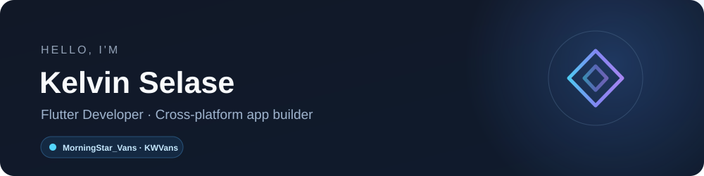
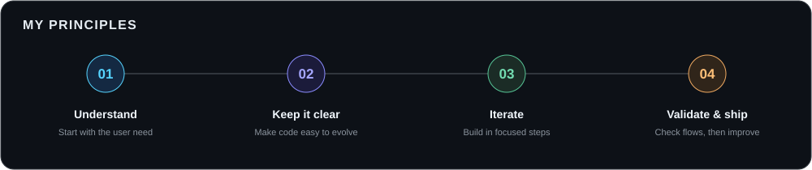
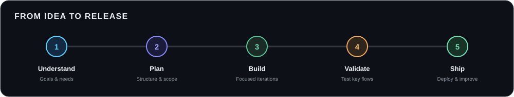
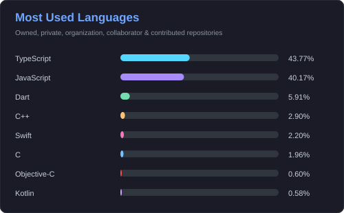
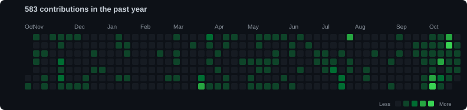
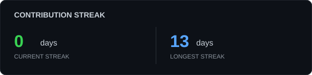

  

  
  

## About Me

I’m Kelvin Selase, known on GitHub as MorningStar_Vans (KWVans). I’m a Flutter developer focused on building cross-platform mobile applications with Dart. I also work across web applications, business tools, and AI-powered products.

Most of my development happens in private repositories, so public code is only one part of my work. My GitHub contribution activity can show private contributions in aggregate without revealing repository names or code.

## What I Do

- Build cross-platform applications with Flutter and Dart
- Develop responsive web applications and product interfaces
- Create dashboards, admin tools, and business workflows
- Integrate cloud backends, authentication, and AI services
- Take products from early prototype through deployment

## Tech Stack

  
  
  
  
  
  
  
  
  
  
  

## How I Work

  

## Flutter Focus

<table>
  <tr>
    <td width="50%" valign="top">
      <h3>🧭 State Management</h3>
      
Keep state changes predictable, UI responsive, and data flow easy to follow.

    </td>
    <td width="50%" valign="top">
      <h3>🏗️ App Architecture</h3>
      
Organize features into clear boundaries so screens, business logic, and data access can evolve independently.

    </td>
  </tr>
</table>

## Project Workflow

  

## Skills

<table>
  <tr>
    <td width="50%" valign="top">
      <h3>📱 Mobile Development</h3>
      
      
      
    </td>
    <td width="50%" valign="top">
      <h3>🌐 Web Development</h3>
      
      
      
      
      
    </td>
  </tr>
  <tr>
    <td width="50%" valign="top">
      <h3>⚙️ Backend & Data</h3>
      
      
      
      
      
    </td>
    <td width="50%" valign="top">
      <h3>✨ AI Integration</h3>
      
      
      
    </td>
  </tr>
  <tr>
    <td colspan="2" valign="top">
      <h3>🚀 Tools & Deployment</h3>
      
      
      
      
    </td>
  </tr>
</table>

## Selected Projects

Some of these projects are private, so the descriptions below share their purpose without exposing repository names, customer information, or implementation details.

<table>
  <tr>
    <td width="50%" valign="top">
      <h3>📱 Flutter Mobile Apps</h3>
      
Cross-platform Android and iOS applications built with Flutter and Dart.

    </td>
    <td width="50%" valign="top">
      <h3>🏨 Hospitality Management</h3>
      
Property, booking, staff, inventory, and revenue workflows for hospitality operators.

    </td>
  </tr>
  <tr>
    <td width="50%" valign="top">
      <h3>🍽️ Food Delivery Marketplace</h3>
      
Backend services coordinating customer, vendor, and driver workflows, payments, and notifications.

    </td>
    <td width="50%" valign="top">
      <h3>🧩 Internal Management Tools</h3>
      
Role-based company tools for documents, processes, and operational collaboration.

    </td>
  </tr>
  <tr>
    <td width="50%" valign="top">
      <h3>📦 Multi-Organization Inventory</h3>
      
Inventory, onboarding, organization management, and access workflows for multiple teams.

    </td>
    <td width="50%" valign="top">
      <h3>🎙️ AI Voice Experiences</h3>
      
Conversational voice-agent prototypes using Google AI services.

    </td>
  </tr>
</table>

## GitHub Stats

  
  

## Contribution Calendar & Streak

  

  

## GitHub Achievements

  
  
  

---

<i>Building useful things, one commit at a time.</i>

